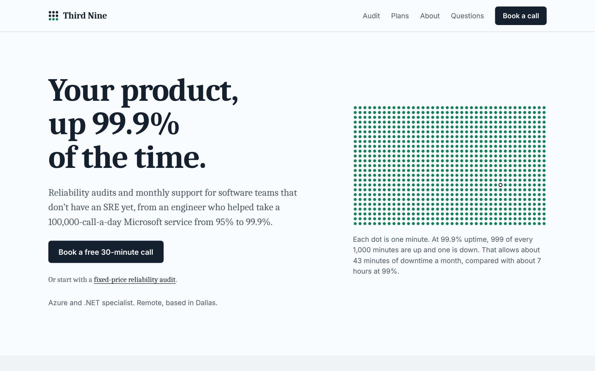
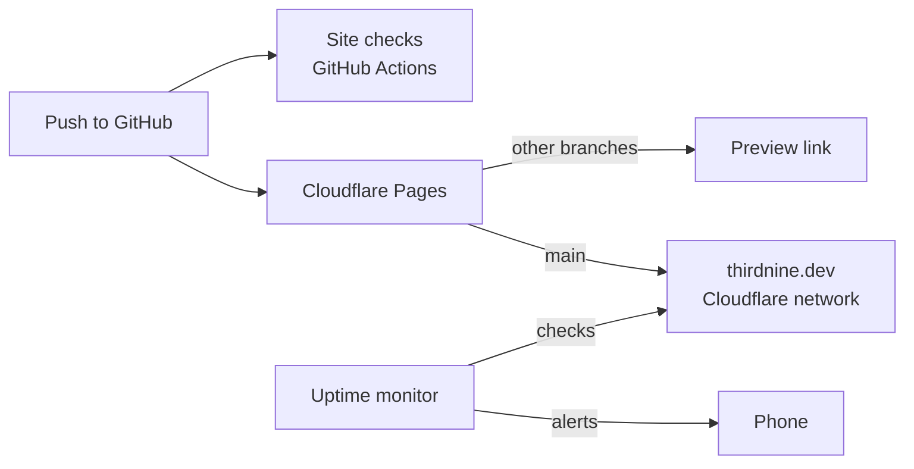

# Third Nine

The website for [Third Nine](https://thirdnine.dev), a one-person reliability practice in Dallas. It offers fixed-price reliability audits and monthly reliability support for small software teams, with a focus on Azure and .NET.

The site itself follows the practices Third Nine sets up for clients: automated checks on every push, strict security headers, a written reliability target, and a runbook for when things break.



<!-- Status badge: replace YOUR-GITHUB-USERNAME below, then remove these comment markers.
[](https://github.com/YOUR-GITHUB-USERNAME/thirdnine-site/actions/workflows/checks.yml)
-->

## How it's built

- **Plain HTML and CSS.** No framework, no build step, no JavaScript, and no requests to other domains. Fewer moving parts means fewer ways to fail.
- **System fonts.** Text is set in Charter on Apple devices and Sitka or Cambria on Windows, so it renders instantly with nothing to download.
- **Light and dark themes** that follow the visitor's device setting.
- **Hosted on Cloudflare Pages.** Every push to `main` deploys to production, and every other branch gets its own preview link.
- **The hero graphic is the brand.** It's 1,000 dots, one per minute, with a single empty one: 99.9% uptime.



## Reliability

- **Target:** 99.9% of uptime checks succeed over any rolling 30 days, about 43 minutes of downtime allowed. See [docs/slo.md](docs/slo.md).
- **Runbook:** step-by-step responses for outages, bad deploys, DNS and email problems. See [docs/runbook.md](docs/runbook.md).
- **Rollback:** any earlier production deployment can be restored from the Cloudflare dashboard in one click.

## Security headers

Set in [`site/_headers`](site/_headers) and applied to every response.

| Header | What it does |
| --- | --- |
| `Strict-Transport-Security` | Browsers only ever connect over HTTPS. |
| `Content-Security-Policy` | Only this site's own stylesheet and images can load. Scripts, frames and outside resources are blocked. |
| `X-Content-Type-Options` | Stops browsers from guessing file types. |
| `X-Frame-Options` | Stops other sites from embedding this one, which prevents clickjacking. |
| `Referrer-Policy` | Shares only the domain, not full addresses, with sites it links to. |
| `Permissions-Policy` | Turns off camera, microphone, location, payment and similar browser features. |
| `Cross-Origin-Opener-Policy` | Keeps windows opened by other sites from reaching this page. |

After launch, check the grade at [securityheaders.com](https://securityheaders.com).

## Automated checks

Every push and pull request runs [`.github/workflows/checks.yml`](.github/workflows/checks.yml):

1. [`scripts/check_site.py`](scripts/check_site.py) checks internal links and anchors, image alt text, the sitemap, structured data, required security headers, and that nothing inline or external would be blocked by the security policy. It uses only the Python standard library.
2. The [W3C Nu HTML Checker](https://validator.github.io/validator/) validates the HTML and CSS.

## Project layout

```text
site/              Everything Cloudflare Pages publishes
  index.html       The page
  404.html         Shown for any address that doesn't exist
  styles.css       All styles, including dark mode
  _headers         Security headers
  favicon.svg, apple-touch-icon.png, og.png, robots.txt, sitemap.xml
docs/              Reliability target, runbook, screenshot
scripts/           The site check
.github/workflows/ The checks that run on every push
```

## Run it locally

```sh
cd site
python3 -m http.server 8788
```

Open <http://localhost:8788>. Run the checks from the repository root with `python3 scripts/check_site.py`.

## Deploy

In Cloudflare: **Workers & Pages → Create application → Pages → Connect to Git**, then choose this repository.

- Framework preset: **None**
- Build command: leave empty
- Build output directory: **`site`**

Then add `thirdnine.dev` under **Custom domains**.

## Editing the site

- **Text:** everything is in `site/index.html`.
- **Booking links:** until there's a booking page, buttons open an email to `hello@thirdnine.dev`. To switch, search `site/index.html` for `mailto:hello@thirdnine.dev?subject=` and replace each with the booking page address: the 30-minute reliability call (4 places: header, hero, plans and contact) and the audit call (1). Use plain links rather than an embedded booking widget, which the security policy would block.
- **Prices:** search for `$2,500`, `$1,500`, `$3,000` and `$5,000`. Also update `priceRange` in the structured data and the prices in the page description at the top of the file.
- **Headshot:** add a square photo as `site/arik.jpg`, then replace `<div class="portrait" aria-hidden="true">A</div>` with ``.

## License

Content and brand © 2026 Third Nine. All rights reserved.
